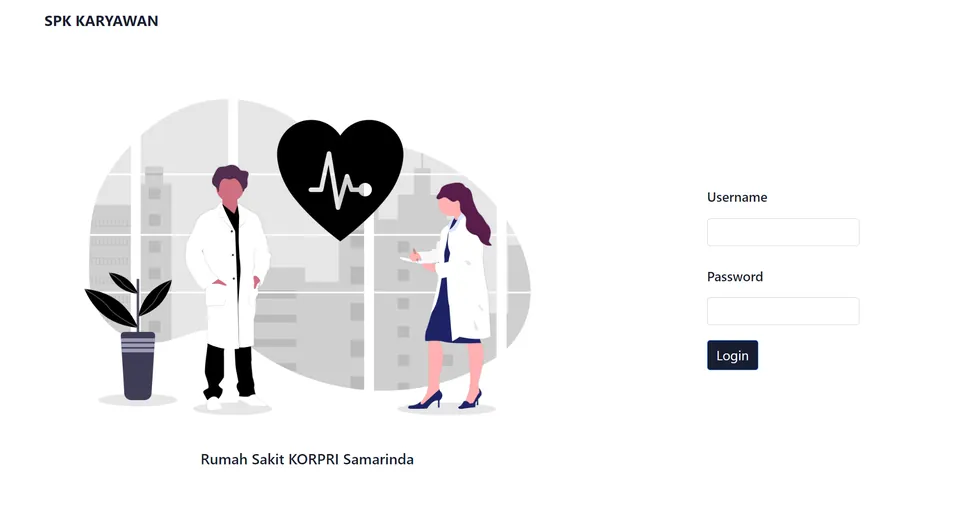

# SPK Perekrutan Karyawan — RS KORPRI Samarinda

Aplikasi web sistem pendukung keputusan (SPK) untuk memeringkat pelamar kerja secara otomatis dengan metode **Weighted Product (WP)**. Dibuat sebagai skripsi S1 Teknik Informatika Universitas Mulawarman (2023).

## Fitur

- **Alternatif:** kelola data pelamar per periode (dataset) dan posisi yang dilamar.
- **Kriteria & bobot:** kriteria dan bobot dapat diubah tanpa mengubah kode. Data contoh memakai 4 kriteria: Pengetahuan Dasar, Uji Kompetensi, Wawancara, dan Tes Praktek.
- **Penilaian & perhitungan:** nilai tiap pelamar dihitung menjadi vektor S dan vektor V sesuai metode WP.
- **Hasil:** peringkat pelamar per posisi, dapat dicetak.
- Login admin.

Diuji dengan 20 data pelamar; hasil perankingan sesuai dengan penilaian manual tim HRD.

## Teknologi

PHP (native) · MySQL · Bootstrap

## Menjalankan secara lokal

1. Pasang XAMPP atau Laragon (PHP + MySQL).
2. Salin folder proyek ke `htdocs` (XAMPP) atau `www` (Laragon).
3. Buat database `spk_karyawan`, lalu impor `spk_karyawan.sql`.
4. Buka `http://localhost/<nama-folder>/login.php`. Akun login ada di tabel `user`.

Pengaturan koneksi database ada di `koneksi.php`.

## Data

Data pelamar pada `spk_karyawan.sql` digunakan dengan izin untuk keperluan penelitian skripsi.
